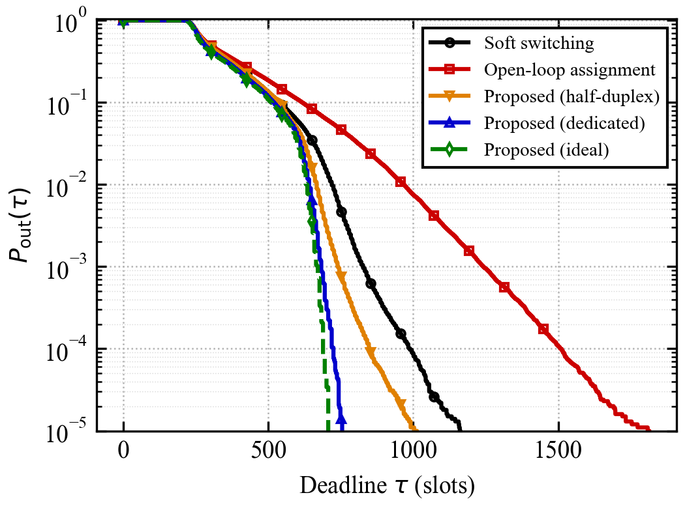
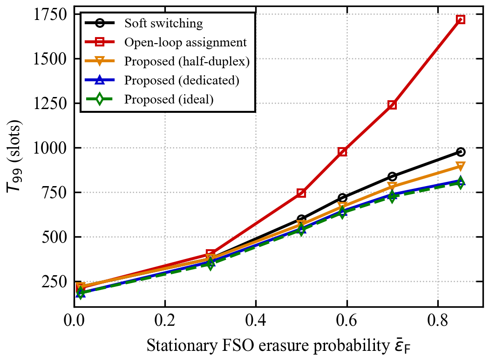

# Rateless Transmission over Hybrid FSO/RF Links with Delivery Deadlines

Simulation code for the letter

> S. K. Modarres, A. P. Chrysologou, N. Chatzidiamantis, R. Schober, and V. K. Papanikolaou,
> "Rateless Transmission over Hybrid FSO/RF Links with Delivery Deadlines," manuscript, 2026.

The repository contains an event-driven, packet-level simulator of a hybrid free space optical (FSO)
and radio frequency (RF) link that carries one rateless-coded stream over both links. It implements
the proposed correlation-aware repair scheme, the two baselines of the letter, and the scripts that
produced every result and figure in it.

## Contents

1. [Background](#1-background)
2. [How the proposed scheme works](#2-how-the-proposed-scheme-works)
3. [Results](#3-results)
4. [Repository structure](#4-repository-structure)
5. [Installation](#5-installation)
6. [Quick start](#6-quick-start)
7. [Reproducing the letter](#7-reproducing-the-letter)
8. [Reproducibility](#8-reproducibility)
9. [Citation, license and references](#9-citation-license-and-references)

## 1. Background

In soft switching [1], one Raptor-coded stream feeds the FSO and RF links at their native rates, and
the receiver decodes from whatever packets arrive on either link. The transmitter needs no channel
knowledge. However, a message is decoded only when enough useful packets have arrived, so the
completion time is random. A link with a delivery deadline is limited by the upper tail of this
completion time, and the tail grows when the FSO link fades in a time-correlated way, for example
during haze. The code studies how a short reception report from the receiver can shorten this tail.

## 2. How the proposed scheme works

The model follows Sections II and III of the letter.

- **Code.** $k=128$ source packets are extended by 10 parity packets (the Raptor precode). Each
  encoded packet is the bitwise XOR of $d$ intermediate packets, where the degree $d$ follows the
  ripple-oriented degree distribution (RODD) [3]. The receiver decodes by peeling.
  *(`python/coding.py`)*
- **Links and correlated channel.** The FSO link runs at 1 Gbit/s and the RF link at 200 Mbit/s over
  1400 m, i.e., with a one-way propagation delay of 4.67 µs. The weather is a two-state Markov chain
  (clear air and haze) that may change every 10 RF packet durations, from clear to haze with
  probability 0.1 and back with probability 0.2 [2]. The FSO erasure probability depends on the
  weather state; the 60 GHz RF erasure probability is 0.0487 in both states [2].
  *(`python/channel.py`)*
- **Reception reports.** After every $W$ packets, the receiver sends a report: a 13-bit position
  followed by $W$ bits, one per packet (1 = received, 0 = erased). It carries no decoder state.
  *(`python/bitmap_protocol.py`)*
- **Mirror decoder.** The transmitter knows every packet it has sent. By replaying the received
  ones, it obtains an exact copy of the receiver's decoder at the time of the report.
- **Predicted decoder.** Packets sent after the last report are added as if received when they are
  likely to arrive: RF packets and repairs always, FSO packets only while the FSO link is good. This
  copy is used to choose repair targets that are not already on their way.
- **FSO quality.** The fraction of FSO packets received in the latest report, $\hat q_\mathrm{F}$,
  is compared with a threshold $\theta$. No extra feedback bits are needed.
- **Repair rule.** At each RF transmission, the transmitter sends a degree-one repair of a missing
  packet if the mirror decoder has stalled (two received packets without progress) or if
  $\hat q_\mathrm{F}<\theta$. Otherwise, both links send ordinary coded packets, exactly as in soft
  switching. *(`python/model.py`)*

The reports can be carried in three ways. All costs are charged in the simulation.

| Feedback architecture | Where reports travel | Cost of one report |
|---|---|---|
| Dedicated | separate reverse link at 200 Mbit/s | $(13+W)$ bits at 200 Mbit/s, then 4.67 µs propagation; lost with probability 0.0487 |
| Half-duplex | the RF data link itself | forward RF idle for $2\times 4.67$ µs + $2\times 3$ µs + $(13+W)$ bits at 200 Mbit/s; lost with probability 0.0487 |
| Ideal (reference) | — | none |

The 3 µs gap is the 60 GHz short interframe space (SIFS) of IEEE 802.11-2024 [4], paid once
before the report and once before the data resume. Each architecture uses its own window $W$
and threshold $\theta$, trained once and then frozen: $W=8$, $\theta=0.6$ (dedicated); $W=512$,
$\theta=0.25$ (half-duplex); $W=16$, $\theta=0.6$ (ideal).

Two baselines are simulated on the same messages: soft switching [1], and an open-loop assignment
that sends only degree-one and degree-two packets on the RF link, without feedback.

## 3. Results

Times are given in slots of 0.8925 µs, the time in which both links together send one packet
of 1071 bits. The completion time $T$ ends when the receiver has decoded all source packets, and
the outage probability for a deadline $\tau$ is $P_\mathrm{out}(\tau)=\Pr\lbrace T>\tau\rbrace$.

### Outage probability versus deadline (Fig. 2 of the letter)

<p align="center"></p>

The figure uses $10^6$ messages per scheme at a stationary FSO erasure probability of 0.59. All
schemes behave alike for most messages and differ in the tail, which sets the deadline. The
proposed scheme shortens the tail of soft switching, and the gain grows as the outage target becomes
stricter:

| Outage target | Soft switching | Proposed, half-duplex | Proposed, dedicated | Proposed, ideal | Open-loop |
|---|---|---|---|---|---|
| $10^{-2}$ | 719 slots | −7% | −11% | −12% | +35% |
| $10^{-4}$ | 989 slots | −14% | −27% | −30% | +52% |
| $10^{-5}$ | 1161 slots | −14% | −35% | −39% | +56% |

At the deadline at which soft switching misses 1% of the messages, dedicated feedback misses about
0.01%. The open-loop assignment, which protects low degrees on every RF packet, is worse than soft
switching; the proposed scheme repairs only when a report shows a stall or a poor FSO link.
Half-duplex feedback improves on soft switching even though the RF link is silent during each
report: the trained window $W=512$ means that 88% of the messages are decoded before the first
report, and only late messages pay for one.

### Deadline for 1% outage versus FSO erasure probability (Fig. 3 of the letter)

<p align="center"></p>

$T_{99}$ is the deadline that 99% of the messages meet; each point uses $10^4$ messages per
scheme. Dedicated feedback shortens $T_{99}$ by 5 to 17% at every FSO erasure probability and
stays close to ideal feedback. Half-duplex feedback gains 5 to 8% when the FSO link is poor
($\bar\varepsilon_\mathrm{F}\ge0.5$) and equals soft switching when it is good
($\bar\varepsilon_\mathrm{F}\le0.3$), because almost every message is then decoded before its first
report. The open-loop assignment falls further behind as the FSO link worsens.

**Plotted data.** `paper_data/fig2_outage.csv` and `paper_data/fig3_deadline.csv` contain the
plotted values. `tau` is the deadline in slots and `eps` the stationary FSO erasure probability.
The scheme columns are `pooling` (soft switching), `open_loop` (open-loop assignment), `hd_lossy`
(half-duplex feedback), `ded_lossy` (dedicated feedback) and `ded_ideal` (ideal feedback). An
outage is reported as `nan` where fewer than ten messages miss the deadline, i.e., where the sample
cannot resolve it.

## 4. Repository structure

| Path | Purpose |
|---|---|
| `python/coding.py` | Parameters (`Config`), Raptor code (precode, RODD degrees, packet codebook) and peeling decoder |
| `python/channel.py` | Two-state Markov weather; FSO (Gamma–Gamma) and RF (Rician) erasure probabilities [2] |
| `python/bitmap_protocol.py` | Report format and the timing of dedicated and half-duplex feedback |
| `python/model.py` | Event-driven simulation of one message: transmitter (mirror, prediction, repair rule), channel and receiver |
| `python/feedback_options.py` | Presets of the feedback architectures and their command-line options |
| `python/optimize_window.py` | Training of $(W,\theta)$ for one architecture, with validation on fresh messages |
| `python/run_comparison.py` | Evaluation campaign with all schemes on paired messages |
| `python/run_replacement.py` | Final evaluation of the real feedback architectures on the campaign's messages |
| `python/experiments.py`, `python/statistics_tools.py` | Parallel runs, checksummed sample storage, quantiles and bootstrap intervals |
| `python/plot_results.py` | Figures and summary statistics |
| `tools/make_final_figures.py` | Verifies all samples and draws the two figures |
| `tools/export_csv.py` | Exports per-message results and figure data to CSV |
| `run_campaign.sh`, `run_replacement.sh` | The scripts that produced the letter's results |
| `examples/quick_start.py` | Small example that runs in under a minute |
| `tests/` | Unit tests |
| `figures/`, `paper_data/` | The two figures of the letter and their data |

## 5. Installation

Python 3.11 or newer is required.

```bash
git clone https://github.com/KhashayarModares/hybrid-fso-rf-rateless-repair.git
cd hybrid-fso-rf-rateless-repair
python -m venv .venv
source .venv/bin/activate        # on Windows: .venv\Scripts\activate
pip install -r requirements.txt
python -m unittest discover -s tests
```

The tests take about ten seconds.

## 6. Quick start

```bash
python examples/quick_start.py --messages 200
```

The script simulates 200 messages per scheme with the settings of the letter and prints the mean
and the 99th percentile of the completion time. With so few messages, the 99th percentile rests on
two samples, so the output only shows that the code runs and orders the schemes sensibly.

A single message can also be simulated directly:

```python
import sys; sys.path.insert(0, 'python')
from dataclasses import replace
from coding import Config
from feedback_options import ARCHITECTURES
from model import simulate

base = Config(eps_fso=0.59)                                  # stationary FSO erasure probability
print(simulate(base, 'pooling', seed=1)['receiver_completion_slots'])        # soft switching

dedicated = replace(base, **ARCHITECTURES['ded_real'], window=8, state_threshold=0.6,
                    feedback_rate_bps=200e6, feedback_loss_probability=0.0487)
print(simulate(dedicated, 'bitmap', seed=1)['receiver_completion_slots'])    # proposed scheme
```

## 7. Reproducing the letter

The full reproduction runs two bash scripts (on Windows, use WSL or Git Bash) and then draws the
figures. `WORKERS` sets the number of parallel processes. Both scripts resume from completed chunks
when they are restarted with the same command.

```bash
# Step 1: training and evaluation campaign (about 10 h with 16 processes)
PY=python3 WORKERS=16 OUT=outputs bash run_campaign.sh

# Step 2: final real-feedback curves on the same messages (about 5 h with 6 processes)
PY=python3 WORKERS=6 OUT=outputs bash run_replacement.sh

# Step 3: verify all samples and draw the two figures into outputs/figures_paper
python tools/make_final_figures.py outputs --result publication_widegrid --dest figures_paper --size 3.5 2.6
```

**Step 1** trains $(W,\theta)$ for every architecture on 2000 messages per condition, validates it
on 4000 fresh messages, and evaluates all schemes on $10^6$ messages at
$\bar\varepsilon_\mathrm{F}=0.59$ and on $10^4$ messages at each of six erasure probabilities. The
letter uses its soft-switching, open-loop and ideal-feedback curves. Its two real-feedback curves
follow a preliminary cost model (10 Mbit/s dedicated link, no report loss, no SIFS) and are
replaced in step 2.

**Step 2** retrains the two real feedback architectures with the final cost model of Section 2
($W$ from 4 to 512), checks that the code reproduces stored results of step 1 exactly, and
evaluates both architectures on the same messages. All statistics are written to
`outputs/publication_widegrid/summary.json`.

**Step 3** checks every sample file against its recorded SHA-256 checksum, recomputes the plotted
data and draws the figures. `python tools/export_csv.py outputs --folders publication_widegrid`
additionally exports the per-message results to CSV.

## 8. Reproducibility

- All schemes are simulated on the same messages and channel realizations (common random
  numbers), so differences between the curves are not caused by different message samples.
- Training, validation and evaluation use disjoint sets of message seeds, and the trained
  $(W,\theta)$ are frozen before the evaluation.
- Every sample file is stored with a SHA-256 checksum, and the figure script stops if any check
  fails.
- The results of the letter were produced with Python 3.12, NumPy 2.4, SciPy 1.17 and
  Matplotlib 3.10/3.11.

## 9. Citation, license and references

If you use this code, please cite the letter given at the top of this page. The code is released
under the MIT license (see `LICENSE`).

[1] W. Zhang, S. Hranilovic, and C. Shi, "Soft-switching hybrid FSO/RF links using short-length
Raptor codes: Design and implementation," *IEEE J. Sel. Areas Commun.*, vol. 27, no. 9,
pp. 1698–1708, 2009.

[2] N. D. Chatzidiamantis, L. Georgiadis, H. G. Sandalidis, and G. K. Karagiannidis,
"Throughput-optimal link-layer design in power constrained hybrid OW/RF systems," *IEEE J. Sel.
Areas Commun.*, vol. 33, no. 9, pp. 1972–1984, 2015.

[3] H. Huang, J. Yin, Y. Fu, and Z. Wang, "Ripple-oriented degree distribution of rateless codes:
A backward design approach for finite block lengths," *IEEE Trans. Veh. Technol.*, vol. 74,
no. 11, pp. 17304–17320, 2025.

[4] *IEEE Standard for Information Technology—Part 11: Wireless LAN Medium Access Control (MAC) and
Physical Layer (PHY) Specifications*, IEEE Std 802.11-2024, 2025.
